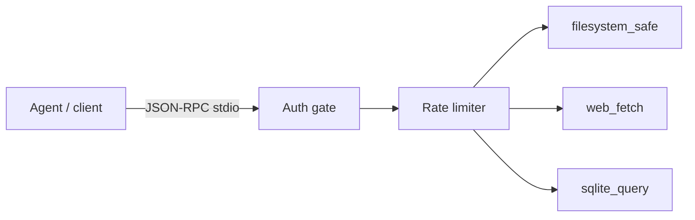

# MCP Server Suite

[](https://github.com/lionelsimai/mcp-server-suite/actions/workflows/ci.yml)
[](LICENSE)
[](https://www.python.org/)

**3 production MCP servers with auth, rate limits, docs.**

**Target:** 500+ installs or adopted by one real team.
**Shows:** You build plumbing others build on.

## Problem -> Solution
Every agent team re-builds the same unsafe tool servers. This suite ships
three hardened MCP servers — filesystem, web fetch, SQLite — over stdio
JSON-RPC with shared bearer auth, token-bucket rate limits and structured
errors, and **zero external SDK dependency** so it installs anywhere.

## Architecture


## Quickstart (<2 min)
```bash
git clone https://github.com/lionelsimai/mcp-server-suite.git
cd mcp-server-suite
pip install -e .
mcp-suite demo
mcp-suite list
export MCP_AUTH_TOKEN="your-token"
mcp-suite serve filesystem_safe --root /data/jail
mcp-suite serve web_fetch --allowlist example.com   # custom domains
```
Serving is **fail-closed**: with `MCP_AUTH_TOKEN` unset, `serve`
refuses to start unless you pass `--allow-unauthenticated` (local dev
only, prints a stderr warning). Client configuration examples
(Claude Desktop / `mcp.json`): [docs/INSTALL.md](docs/INSTALL.md).

## Real demo output
```
filesystem_safe read: hello from filesystem_safe
web_fetch first: <html>fetched https://example.com/a</html>
web_fetch cached: <html>fetched https://example.com/a</html> (network calls: 1)
sqlite_query result: {"columns": ["name"], "rows": [["alpha"], ["beta"]]}
sqlite_query write blocked: tool execution failed (isError=True)
auth check (wrong token): unauthorized: bad or missing token
```
Tool failures follow MCP semantics (0.1.1): they return a result with
`isError: true` and a generic message — internal error text is never
leaked to clients. Protocol errors (auth, rate limit, unknown tool)
remain JSON-RPC errors.

## Servers
- **filesystem_safe** — jailed `list_dir` / `read_file`. [README](servers/filesystem_safe/README.md)
- **web_fetch** — allowlisted, cached `fetch`. [README](servers/web_fetch/README.md)
- **sqlite_query** — read-only `query`. [README](servers/sqlite_query/README.md)

Install details: [docs/INSTALL.md](docs/INSTALL.md).

## Benchmarks
```bash
python benchmarks/bench.py
```
Measures in-process requests/sec (1,000 calls) and verifies rate-limit
behaviour (capacity-5 bucket admits exactly 5 of 20 rapid calls).

## Limitations (honest)
- Minimal protocol subset (no streaming, resources or prompts yet).
- Auth is one shared bearer token, not per-client credentials / OAuth;
  it travels in each request's `_meta.token`, not a transport header.
- Web fetch cache is in-memory and per-process.
- Redirect handling caps at 5 hops and re-validates each hop against
  the allowlist; content types are not inspected.
- SQLite guard is keyword-based defence-in-depth on top of SQLite's
  own read-only mode, not a formal proof of read-only-ness.

## Roadmap
- [ ] Resources/prompts support, per-client tokens, persistent cache
- [ ] PyPI release, Docker images per server
- [ ] Conformance run against the official MCP inspector

## Contributing
See [CONTRIBUTING.md](CONTRIBUTING.md). Licence: MIT — see [LICENSE](LICENSE).
